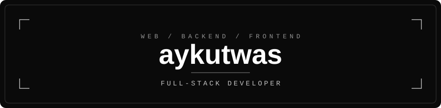

 

---

## About

Full-stack developer building fast, clean web applications from database to interface.
Part of [@visperco](https://github.com/visperco). Simple code, solid architecture, steady shipping.

---

## Tech Stack

**Languages**

**Frameworks & Runtime**

**Databases & DevOps**

---

## What I Build

| Frontend | Backend |
| :--- | :--- |
| Responsive interfaces with React and Vue | REST APIs and services in Node.js, Go and Python |

| Data | DevOps |
| :--- | :--- |
| Relational schemas on PostgreSQL and MySQL | Containerized deployments with Docker and Kubernetes |

---

*Build clean. Ship steady.*

