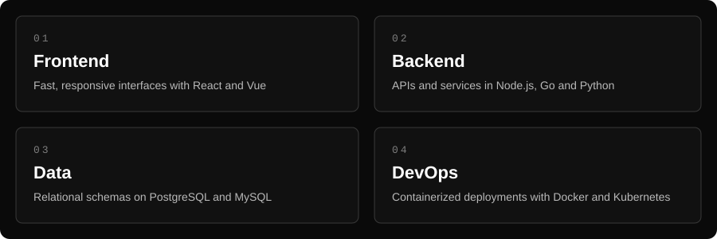

 

---

## About

I turn ideas into fast, reliable web products. Clean code, thoughtful design, and the small details that make software feel right.

---

## Tech Stack

**Languages**

**Frameworks & Runtime**

**Databases & DevOps**

---

## What I Build

---

*Build clean. Ship steady.*

